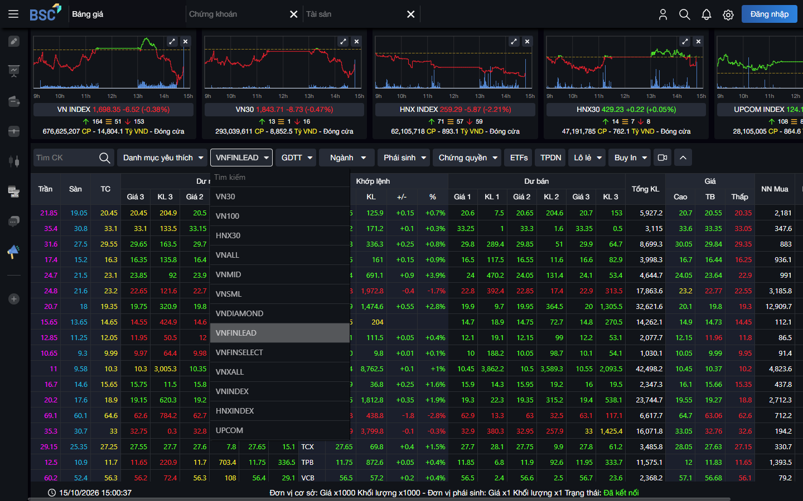
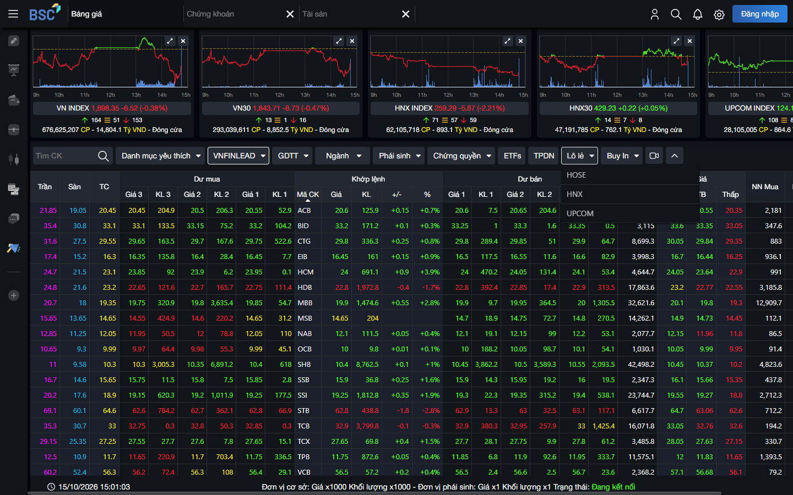
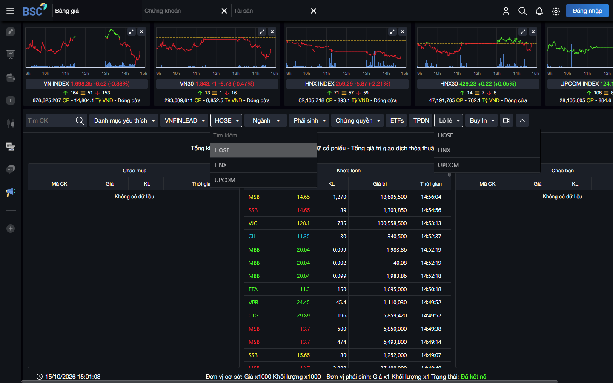
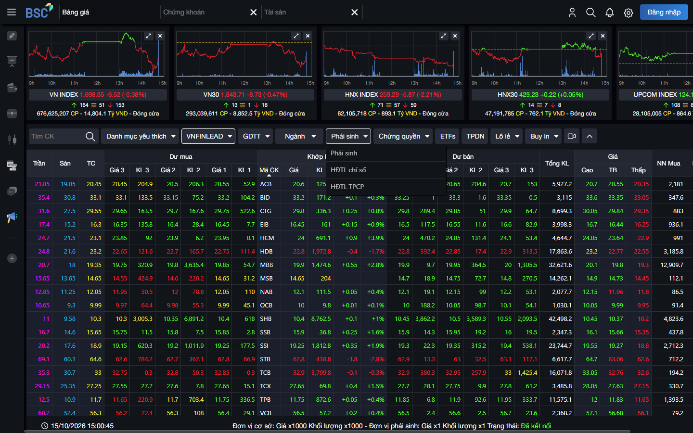
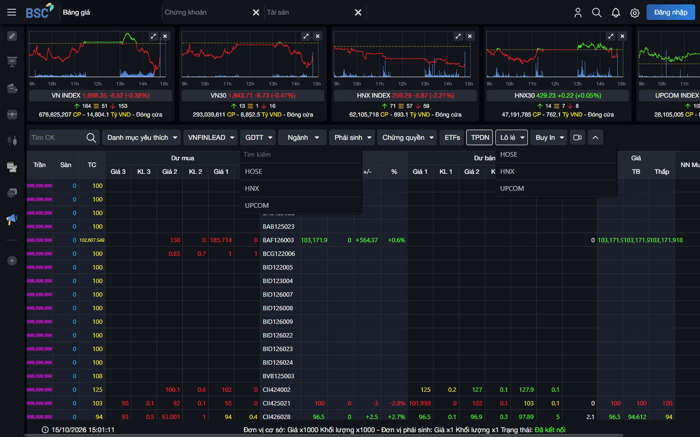

# BSC WebTrading — từ bảng giá realtime đến Order Command

<div class="lesson-meta">
  <span><strong>Broker</strong> BSC / BIDV Securities</span>
  <span><strong>Evidence</strong> 🟢 Public Playwright · 🟡 Official docs</span>
  <span><strong>Khảo sát</strong> 15/10/2026 · READ-ONLY · non-transactional</span>
</div>

BSC là case study mạnh nhất trong repo này cho:

```text
Market-data projection (3-level depth)
→ multi-product boards trên cùng một UI
→ public → authenticated trading boundary
→ (official) click bid/ask → order intent
```

Public evidence **không** chứng minh protocol nội bộ, database, event bus, FIX engine hay topology OMS của BSC.

## 1. Why BSC is useful for learning

So với SSI (margin/cash) hay VPS (order status/sellable qty), BSC public priceboard cho backend developer nhìn rõ:

| Hiện tượng UI | Bài học engineering |
|---|---|
| 3 mức dư mua / dư bán | Quote projection ≠ central order book |
| Tab GDTT khác cấu trúc board thường | Negotiated workflow ≠ continuous matching |
| Tab TPDN dùng `Mã HĐ` | One UI ≠ one instrument model |
| Phái sinh submenu HĐTL chỉ số / HĐTL TPCP | Derivatives contract semantics riêng |
| Chứng quyền có cột Giá TH / TLCĐ / CKCS / ĐHV | Warrant fields ≠ equity fields |
| Footer `Đang kết nối` / `Đã kết nối` | Transport state ≠ data freshness |
| Nút **Đăng nhập** trên mọi public board | Market data selection ≠ authorized order submit |

## 2. Evidence scope

| Mức | Phạm vi phiên 15/10/2026 |
|---|---|
| 🟢 Observed UI | Playwright trên `https://trading.bsc.com.vn/priceboard` (public, có nút Đăng nhập) |
| 🟡 Official docs | Hướng dẫn WebTrading, lệnh điều kiện, GDTT online, giao dịch cơ sở/phái sinh |
| 🟣 Authenticated client | **Không** — không login, không mở ProTrading/sổ lệnh/portfolio thật |
| 🔵 Reference design | Các model/command/state machine đề xuất trong course |
| 🔴 Not verified | Order form fields thật, buying power, conditional UI, submit path, internal transport architecture |

Công cụ: **MCP Playwright** trên ứng dụng đã render — không dựa vào `curl`/HTML tĩnh.

## 3. Priceboard overview

**Route ban đầu:** `/priceboard` · **Title:** `Bảng giá - BSC`

**Nav trên:** Bảng giá · Chứng khoán (`/symbol-detail`) · Tài sản (`/asset-total`, public vẫn thấy label) · **Đăng nhập**

**Chỉ số header (🟢):** VN INDEX, VN30, HNX INDEX, HNX30, UPCOM — sparkline, điểm/%, số mã tăng/giảm, KL/giá trị, nhãn phiên (`Phiên GDTT`, `PLO`, `Đóng cửa`, …).

**Tab bar quan sát được (🟢):**

```text
Danh mục yêu thích
<Index selector>     ← label động: VN30 | VNFINLEAD | …
GDTT                 ← có thể đổi label thành HOSE/HNX/UPCOM sau chọn sàn
Ngành                ← popover ngành (Ngân hàng, BĐS, …)
Phái sinh            ← HĐTL chỉ số · HĐTL TPCP
Chứng quyền          ← Toàn thị trường · BSC phát hành
ETFs
TPDN
Lô lẻ                ← HOSE · HNX · UPCOM
Buy In               ← HOSE · HNX · UPCOM
```

Index selector (khi mở) còn liệt kê thêm các board kiểu VN100, HNX30, VNALL, VNMID, VNSML, VNDIAMOND, …



> 🟢 Public UI · 15/10/2026  
> **Observed:** board chỉ số (VNFINLEAD), 3-level depth, nút Đăng nhập, tab đa sản phẩm.  
> **Proves:** public priceboard là multi-board market-data shell.  
> **Does not prove:** kiến trúc feed nội bộ hay ownership của matching engine.  
> **Learn:** [Domain 05](/domains/05-realtime-analytics) · [Bài 10](/lectures/10-market-data-engineering/).


> 🟢 Public UI · 15/10/2026  
> **Observed:** selector chỉ số (VN30, VN100, HNX30, …) trên cùng shell bảng giá.  
> **Proves:** một UI shell phục vụ nhiều universe lọc.  
> **Does not prove:** mỗi universe là bounded context riêng ở backend.

## 4. Market-depth anatomy

Trên board cổ phiếu (VN30 / VNFINLEAD) và nhiều board khác, header quan sát được:

```text
Trần / Sàn / TC

Dư mua
  Giá 3 · KL 3
  Giá 2 · KL 2
  Giá 1 · KL 1

Khớp lệnh
  Mã CK · Giá · KL · +/- · %

Dư bán
  Giá 1 · KL 1
  Giá 2 · KL 2
  Giá 3 · KL 3

Tổng KL
Cao / TB / Thấp
NN Mua / NN Bán / NN Room
```

**Độ sâu = 3 mức** mỗi phía — xác nhận lại bằng Playwright ngày 15/10/2026, không giữ claim cũ theo giả định.

Footer còn ghi đơn vị hiển thị (🟢): cơ sở Giá/KL ×1000; phái sinh Giá/KL ×1.


> 🟢 Public UI · 15/10/2026  
> **Observed:** ba mức bid và ba mức ask; last/change; foreign columns.  
> **Proves:** public board expose **depth projection**.  
> **Does not prove:** BSC sở hữu central order book hoặc storage technology cụ thể.  
> **Learn:** [Bài 06 — Order Matching](/lectures/06-order-matching/) · [Bài 10](/lectures/10-market-data-engineering/).

Mental model đúng:

```text
Venue / market-data source
        ↓
   normalize / project
        ↓
   Priceboard UI
        ↓
      User
```

## 5. Symbol interaction

| User Action | UI Result (🟢) | Business Meaning |
|---|---|---|
| Click mã (vd. HPG) trên board public | Ở lại `/priceboard`; không mở dialog login/password | Selection trên projection; **chưa** phải order command |
| Double-click mã | Không quan sát thấy chuyển sang ticket authenticated trong phiên public | 🔴 Prefill side/price từ double-click chưa verify trên public session |
| Click ô giá (thử nghiệm) | Không mở form đặt lệnh / password trong phiên này | Boundary order-entry trên public **không** được xác nhận bằng UI lần này |
| Mở `/symbol-detail` | Trang công khai: đồ thị, thông tin chỉ số, chứng khoán thành phần | Research/detail surface tách khỏi priceboard grid |
| Mở `/asset-total` khi chưa login | Quay về shell public; vẫn thấy **Đăng nhập** | Asset surface đòi auth — không inspect holdings |

## 6. Priceboard → Order Intent

🟢 Public session **không** mở được order ticket thật.

🟡 Official BSC (`giao-dich-chung-khoan-co-so`, tương tự phái sinh) mô tả:

```text
Chọn nút “Giao dịch”
  hoặc chọn trực tiếp giá dư mua / dư bán trên bảng giá
→ chọn tiểu khoản
→ hoàn thiện Limit/Market hoặc lệnh điều kiện
→ Mua/Bán → xác nhận → xác thực
```

Đây là ranh giới kiến trúc quan trọng:

```text
Market Data Selection
        ↓
Order Draft / Intent   (prefill symbol/side/price)
        ↓
Validation / Risk / Reservation
        ↓
Final Submit (auth)
```

Click giá **không** đồng nghĩa lệnh đã ra Sở.

## 7. Order-entry boundary


> 🟢 Public UI · 15/10/2026  
> **Observed:** toàn bộ priceboard public kèm CTA **Đăng nhập**.  
> **Proves:** market-data surface tách khỏi authenticated trading surface.  
> **Does not prove:** field list của order form, PIN/OTP flow, hay buying-power calculation.  
> **Learn:** [Domain 01](/domains/01-securities-core) · [Bài 13 — OMS state machine](/lectures/13-oms-internals-state-machine/).

| Field / capability | Evidence |
|---|---|
| Account / tiểu khoản | 🟡 Official — bắt buộc chọn khi đặt lệnh |
| Symbol / side / type / price / qty / validity | 🟡 Official |
| Conditional fields (giá kích hoạt, biên độ, bước giá, …) | 🟡 Official |
| Buying power / sellable / fee / PIN-OTP UI | 🔴 Not observed this session |
| ProTrading composition | 🟡 Official (+ PDF HDSD) — 🔴 screen chưa mở |

## 8. ProTrading

🟡 Official WebTrading page / HDSD mô tả màn **Đặt lệnh Pro / ProTrading** như composition nhiều vùng thông tin + ticket.

Không mở được trong phiên public → **không** nâng lên 🟢.

🔵 Reference lesson (course):

```text
One Trading Screen
= composition of multiple projections + command surfaces

≠ one backend aggregate owns everything
```

## 9. Conditional Orders

Không tạo / không mở form lệnh điều kiện (READ-ONLY).

🟡 Official (`bo-lenh-dieu-kien`, `gioi-thieu-lenh-dieu-kien`, hướng dẫn cơ sở):

- LO-GTC, Stop-Limit, Trailing Stop, OCO, TP/SL  
- Khái niệm: giá kích hoạt, giá đặt, biên độ, bước giá, khối lượng, hiệu lực  
- Lệnh con sinh ra sau khi điều kiện thỏa

```text
Conditional Order Definition
        ↓ trigger
Generated Trading Order
        ↓
Risk / OMS
```

Cross-link: [Domain 06](/domains/06-conditional-orders).

## 10. Odd-Lot

🟢 Tab **Lô lẻ** với submenu **HOSE / HNX / UPCOM**. Sau khi chọn HOSE, tab label có thể đổi thành tên sàn; board vẫn dùng khung depth 3 mức + `Mã CK`, universe mã rộng (AAA, AAM, …).

🟡 Official: khối lượng lô lẻ 1–99; hướng dẫn dùng bảng giá lô lẻ riêng; gom lô lẻ về một tiểu khoản khi bán.

```text
Odd-lot = market / routing mode có rule riêng
≠ RegularOrder với Qty < 100 (đơn giản hóa nguy hiểm)
```



> 🟢 Public UI · 15/10/2026  
> **Observed:** entry point Lô lẻ + submenu sàn (và/hoặc board sau khi chọn).  
> **Proves:** odd-lot là board mode riêng trên UI.  
> **Does not prove:** matching rule chi tiết hay settlement path.  
> **Learn:** Domain 01 + market rules.

## 11. Negotiated Trading / GDTT

🟢 Tab GDTT (label có thể thành HOSE sau khi chọn sàn con). Cấu trúc **khác** continuous board:

```text
Tổng KL / tổng GT giao dịch thỏa thuận
Chào mua  → Mã CK · Giá · KL · Thời gian   (có lúc “Không có dữ liệu”)
Khớp lệnh → Mã CK · Giá · KL · Giá trị · Thời gian
Chào bán  → …
```

Không có lưới 3-level dư mua/dư bán như board liên tục.



> 🟢 Public UI · 15/10/2026  
> **Observed:** chào mua/bán + tape khớp thỏa thuận + tổng KL/GT.  
> **Proves:** GDTT là projection/workflow surface riêng.  
> **Does not prove:** state machine xác nhận hai phía hay API nội bộ.  
> **Learn:** continuous matching vs negotiated trade.

🟡 Official: tính năng giao dịch thỏa thuận trực tuyến trên WebTrading (announcement + quy định giao dịch).

```text
Continuous Order → central matching
Negotiated Trade → đối tác thống nhất điều khoản → workflow xác nhận
```

Không giả định cùng một OMS state machine.

## 12. Derivatives

🟢 Popover **Phái sinh**:

```text
HĐTL chỉ số
HĐTL TPCP
```

🟢 Board **HĐTL TPCP** (đã mở thành công trong phiên): depth vẫn 3 mức; thêm cột kiểu **KL mở**, **Mở cửa**; mã hợp đồng dạng `41B…`; ngày đáo hạn hiển thị trên hàng.

Board **HĐTL chỉ số** (VN30F…): submenu quan sát được; chi tiết cột index-futures không ổn định chụp lại cuối phiên → ghi nhận submenu 🟢, anatomy đầy đủ index futures một phần 🔴 nếu cần screenshot riêng.



> 🟢 Public UI · 15/10/2026  
> **Observed:** submenu phái sinh và/hoặc board HĐTL.  
> **Proves:** derivatives là product board riêng trong cùng shell.  
> **Does not prove:** margin/MTM engine nội bộ.  
> **Learn:** [Domain 02 — Derivatives](/domains/02-derivatives-core).

```text
One UI Platform ≠ One Domain Model
```

## 13. Warrants / ETF / Bonds

### Chứng quyền (🟢)

Popover: **Toàn thị trường** · **BSC phát hành**.  
Board có mã dạng `CACB25…`; ngoài depth còn cột instrument-specific quan sát được: **Giá TH**, **TLCĐ**, **CKCS**, **ĐHV**.

### ETFs (🟢)

Tab **ETFs** — cùng khung depth equity; mã quan sát: `E1VFVN30`, `FUE…` (nhiều quỹ ETF).

### TPDN (🟢 view / 🔴 lifecycle)

Tab **TPDN** — cột trung tâm **`Mã HĐ`** (vd. `BAB124016`, `BAF126003`, …), vẫn có khung 3-level depth + NN columns. Trần/sàn có thể hiện giá trị cực đại/0 tùy mã.



> 🟢 Public UI · 15/10/2026  
> **Observed:** market/product view TPDN với `Mã HĐ`.  
> **Proves:** public UI có bond/product board.  
> **Does not prove:** authenticated bond order lifecycle, coupon/accrued, hay settlement bond.  
> **Wording chuẩn:** *Public UI confirms a TPDN market/product view; authenticated bond lifecycle remains unverified.*

### Buy In (🟢 label)

Tab **Buy In** + submenu HOSE/HNX/UPCOM tồn tại trên UI. Ý nghĩa nghiệp vụ đầy đủ / quy tắc Buy-In: bổ sung bằng rule Sở — không suy từ tên tab.

## 14. Foreign activity / room

🟢 Cột **NN Mua / NN Bán / NN Room** trên board cổ phiếu, ETF, TPDN (và các board depth tương tự).

Đây là market/reference projection — tách khỏi OMS order state.

## 15. Connectivity / freshness

🟢 Footer quan sát:

| Class / text | Ý nghĩa UI |
|---|---|
| `CONNECTING` · **Đang kết nối** | Đang thiết lập / chưa ổn định |
| `CONNECTED` · **Đã kết nối** | UI báo đã kết nối |
| Timestamp `dd/MM/yyyy HH:mm:ss` | Đồng hồ/footer cập nhật |

Cũng thấy nút/label kiểu **Thử lại** trong một số trạng thái tải.


> 🟢 Public UI · 15/10/2026  
> **Observed:** footer trạng thái kết nối + timestamp.  
> **Proves:** connection state là first-class UI concern.  
> **Does not prove:** sequence recovery, gap detection, hay websocket frame format.  
> **Learn:** [Bài 10 — Market Data Engineering](/lectures/10-market-data-engineering/).

```text
Transport connected
≠ data fresh
≠ all sequences complete
≠ market session valid
```

### Network (high-level, no secrets)

Browser resource timing (🟢 hostname/path công khai):

- `priceapi.bsc.com.vn` — datafeed instruments / index snaps / charts  
- `tradeapi.bsc.com.vn` — trade quotes, userdata time/date, `realtime/connectioninfo/connection`  
- Không lưu header Authorization, cookie, token, hay payload riêng tư.

Không suy từ đó thành “event-driven microservices”.

## 16. UI → Domain mapping

| UI observation | Domain / concept | Authority |
|---|---|---|
| 3-level depth, last, OHLC-ish | Domain 05 quote projection | Venue MD / broker MD service |
| Index tabs / ngành filter | Reference / universe | Reference data |
| GDTT tape | Negotiated trade projection | Market rules + broker workflow |
| TPDN `Mã HĐ` | Bonds product view | 03 (partial public) |
| HĐTL / CW columns | Derivatives / warrants | 02 + instrument master |
| Đăng nhập CTA | Authn boundary | Identity |
| (Official) tiểu khoản + ticket | Order command context | 01 + Risk |
| (Official) lệnh điều kiện | Trigger definition | 06 |

## 17. Architecture lessons

1. **Projection trước, aggregate sau** — priceboard là read model.  
2. **Selection ≠ command** — click giá chỉ là intent khi đã auth + confirm.  
3. **Product boards chia sẻ shell, không chia sẻ invariants.**  
4. **GDTT và continuous là hai lifecycle.**  
5. **Freshness/connection phải là state máy khách hiểu được.**  
6. **Reference design của course ≠ implementation BSC.**

## 18. What cannot be inferred

Không khẳng định:

```text
BSC dùng WebSocket frame X / SignalR / …
BSC lưu depth trong Redis
BSC OMS là microservice + Kafka
Click giá luôn prefill side trên mọi phiên
Authenticated ProTrading layout pixel-perfect như PDF
```

Chỉ nói:

```text
UI/docs expose capability X
→ capability cần state/invariant Y
→ course dạy reference design Z
```

## 19. Failure scenarios (học, không tấn)

| Scenario | Câu hỏi backend |
|---|---|
| UI `Đã kết nối` nhưng giá không đổi | Stale vs connected? |
| User click Ask khi board stale | Có chặn submit không? Risk dùng price nào? |
| Duplicate click / double submit | Idempotency key? |
| GDTT đối tác không confirm | Timeout / cancel states? |
| Odd-lot qty > holdings lẻ | Validation thuộc rule nào? |

## 20. Backend exercises

### Bài 1 — Canonical quote

Model hóa Trần/Sàn/TC, bid[3], ask[3], last, total volume, foreign room, freshness metadata — tách reference vs quote vs trade.

### Bài 2 — Click-to-trade boundary

Từ official flow: prefill → tiểu khoản → validate → auth → risk → OMS. Chứng minh click không tự tạo live order.

### Bài 3 — Disconnect

UI mất kết nối ngay sau khi user thấy giá. Định nghĩa stale threshold, submit policy, recovery (snapshot vs incremental), metrics.

### Bài 4 — GDTT vs continuous

Hai command/lifecycle riêng — không ép một state machine.

### Bài 5 — Multi-product order context

`SubmitOrder` mang `Product`, `TradingAccountId`, `SubAccountId` — không chỉ symbol/price/qty.

## 21. Official sources

- Priceboard: https://trading.bsc.com.vn/priceboard  
- WebTrading: https://www.bsc.com.vn/bsc-web-trading/  
- HDSD PDF: https://www.bsc.com.vn/Download/HDSD_BSC_Webtrading_ct.pdf  
- Giao dịch cơ sở: https://www.bsc.com.vn/giao-dich-chung-khoan-co-so/  
- Giao dịch phái sinh: https://www.bsc.com.vn/giao-dich-chung-khoan-phai-sinh/  
- Bộ lệnh điều kiện: https://www.bsc.com.vn/bo-lenh-dieu-kien/  
- Giới thiệu lệnh điều kiện: https://www.bsc.com.vn/gioi-thieu-lenh-dieu-kien  
- GDTT online announcement: https://www.bsc.com.vn/tin-tuc/tin-chi-tiet/91088-bsc-ra-mat-tinh-nang-giao-dich-thoa-thuan-truc-tuyen-tren-nen-tang-webtrading/  
- Quy định giao dịch chung: https://www.bsc.com.vn/quy-dinh-giao-dich-chung/  
- Hướng dẫn đọc bảng điện: https://www.bsc.com.vn/tin-tuc/tin-chi-tiet/92817-huong-dan-cach-doc-bang-dien-chung-khoan/

→ [Broker Domain Matrix](./broker-domain-matrix) · [Visual Gallery](./visual-gallery) · [Screenshot inventory](./screenshots/)
